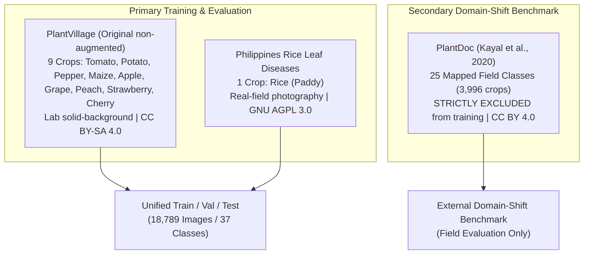

# Dataset Card: 10-Crop Leaf Pathology Benchmark

> **Mandatory Disclaimer**: The output of models trained on this system is an **AI-assisted indication, NOT a guaranteed agricultural diagnosis**. Critical agricultural interventions, pesticide deployments, and crop culling must be validated by trained agronomists and laboratory assays.

---

## 1. Overview & Provenance
This dataset card documents the three agricultural image datasets supporting the multi-class leaf disease diagnosis system.



---

## 2. Dataset Citations, Licenses & Acquisition Metadata

### 1. PlantVillage (Primary Lab Dataset)
- **Source**: spMohanty / EPFL & Penn State University.
- **Version**: Original, non-augmented laboratory photography (verified by unique UUID filename hashes).
- **License**: Creative Commons Attribution-ShareAlike 4.0 International ([CC BY-SA 4.0](https://creativecommons.org/licenses/by-sa/4.0/)).
- **Download Date**: October 2026.
- **Citation**:
  ```bibtex
  @article{mohanty2016using,
    title={Using deep learning for image-based plant disease detection},
    author={Mohanty, Sharada P and Hughes, David P and Salath{\'e}, Marcel},
    journal={Frontiers in plant science},
    volume={7},
    pages={1419},
    year={2016},
    publisher={Frontiers}
  }
  ```
- **Visual Style**: Controlled laboratory conditions. Detached leaves flat on solid gray, white, or black backdrops with uniform illumination.

### 2. Philippines Rice Leaf Disease Dataset (Rice Field Benchmark)
- **Source**: Kaggle repository `shrupyag001/philippines-rice-diseases`.
- **License**: GNU Affero General Public License v3.0 ([AGPL-3.0](https://www.gnu.org/licenses/agpl-3.0.en.html)).
- **Download Date**: October 2026.
- **Citation**:
  ```bibtex
  @misc{philippines_rice_2023,
    title={Philippines Rice Leaf Diseases Dataset},
    author={Shrupyag et al.},
    year={2023},
    publisher={Kaggle},
    howpublished={\url{https://www.kaggle.com/datasets/shrupyag001/philippines-rice-diseases}}
  }
  ```
- **Visual Style**: Outdoor paddy field photography under natural daylight, direct sun angles, ambient vegetation shadows, and soil backgrounds.

### 3. PlantDoc (Field Benchmark & Domain Adaptation)
- **Source**: Indian Institute of Technology (IIT) Kharagpur & Roboflow.
- **License**: Creative Commons Attribution 4.0 International ([CC BY 4.0](https://creativecommons.org/licenses/by/4.0/)).
- **Download Date**: October 2026.
- **Citation**:
  ```bibtex
  @inproceedings{singh2020plantdoc,
    title={PlantDoc: a dataset for collaborative computer vision based plant disease detection},
    author={Singh, Davinder and Jain, Naman and Jain, Pranjali and Kayal, Pratik and Kumawat, Sudhakar and Batra, Nipun},
    booktitle={Proceedings of the 7th ACM IKDD CoDS and 25th COMAD},
    pages={249--253},
    year={2020}
  }
  ```
- **Role in Project**:
  - **v1.0.0**: Used exclusively as an external benchmark test set.
  - **v1.1.0 (Field Domain Adaptation & OOD Rejection)**:
    - **Official PlantDoc TRAIN Split**: Partitioned by whole-scene image group (85% train, 15% validation) to guarantee zero scene leakage. Provides 3,148 field training crops and 522 field validation crops across 25 supported classes.
    - **Unsupported Crop Rejection Data**: Extracts 613 crops (520 train, 93 val) from unmapped categories (Squash, Blueberry, Raspberry, Soybean) labeled under internal class `Unsupported___Unsupported_crop`.
    - **Official PlantDoc TEST Split**: **STRICTLY HELD OUT as field test benchmark** (`data/manifests/field_test_heldout.csv` with 323 crops, and `data/manifests/field_test_unsupported.csv` with 65 crops). Never seen during training or tuning.

---

## 3. Dataset Inspection & Quality Metrics

- **Total Ingested Images**: 18,789 raw image files
- **Cleaning & Filtering**: 20 unreadable/corrupt/tiny images removed in Phase 2 data cleaning, yielding 18,769 verified clean laboratory and rice images.
- **v1.0.0 Partitions (37 Classes)**:
  - Train: 13,127 images (70%)
  - Validation: 2,813 images (15%)
  - Lab Test: 2,829 images (15%)
- **v1.1.0 Retraining Partitions (38 Classes: 37 Supported + 1 Internal Reject)**:
  - Train: 17,458 images (Lab + PlantDoc Train Field Crops + 520 Unsupported Crops + Rice Oversampling)
  - Validation: 3,428 images (Lab Val + PlantDoc Val Field Crops + 93 Unsupported Crops)
  - Lab Test (Untouched): 2,829 images
  - Field Test (Held-Out PlantDoc Test): 323 supported field crops
  - Field Unsupported Test (Held-Out PlantDoc Test): 65 unsupported crops
- **Color Mode**: 100% RGB (3-channel)
- **File Formats**: 100% standard JPEG (`.jpg`/`.jpeg`)
- **Resolution Distribution**:
  - Modal resolution: $256 \times 256$ pixels (PlantVillage standard)
  - Minimum resolution: $64 \times 64$ pixels (Enforced bounding box threshold)
  - Maximum resolution: $4000 \times 3000$ pixels (Field photography)
- **Leakage Verification (v1.1.0 Audit)**:
  - Exact MD5 hash collisions: **0** across Train, Val, Lab Test, and Field Test.
  - Scene Group-ID collisions: **0** across Train and Val.
  - Perceptual hash (pHash Hamming distance $\le 3$) collisions: **0** between Train and Held-Out Field Test.
